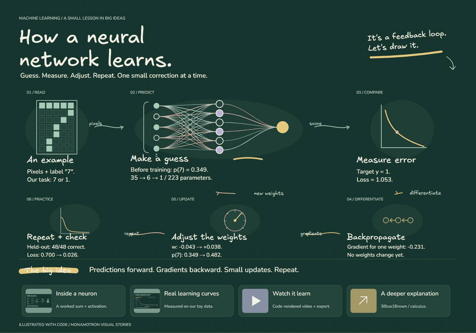
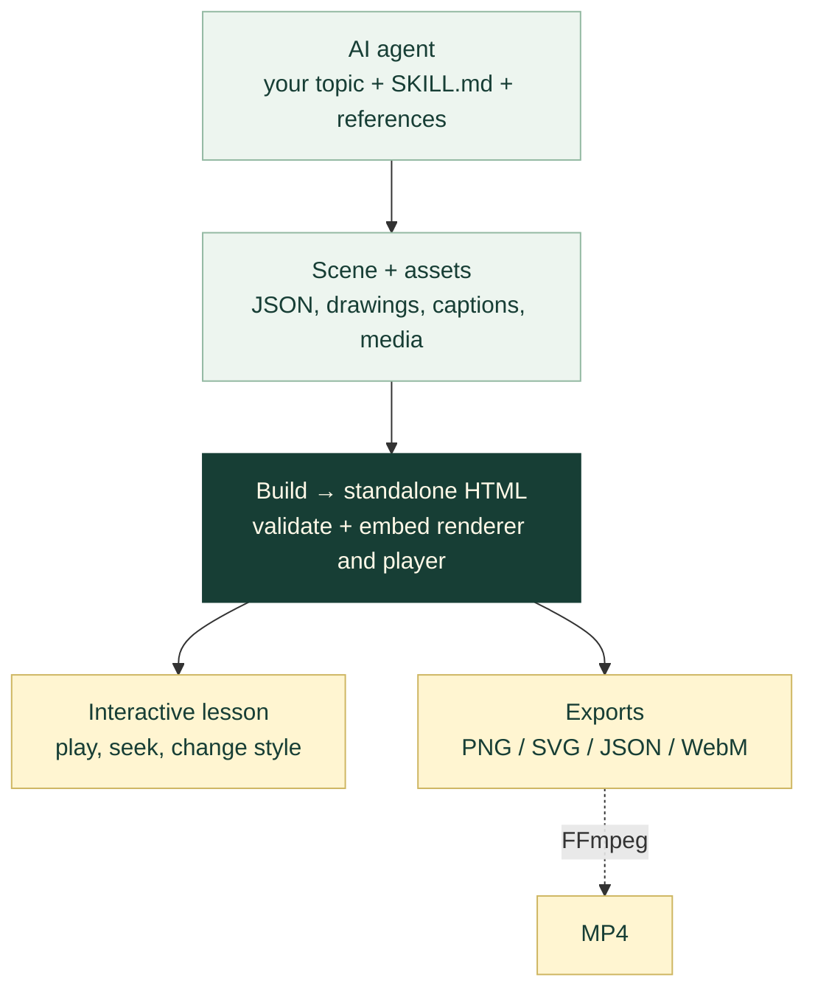

<div align="center">

# Monamotron

**Your AI explains ideas by drawing them.**

A portable AI skill that turns a topic into an illustrated, animated lesson.<br>
Original code-drawn art. Handwritten explanations. A video you can actually export.

[](https://github.com/ibrahim-hero/monamotron/actions/workflows/ci.yml)
[](LICENSE)
[](package.json)
[](skill/monamotron/SKILL.md)

[**Try the interactive demo**](https://ibrahim-hero.github.io/monamotron/) · [**Watch the video**](https://ibrahim-hero.github.io/monamotron/video.html) · [**Get started**](#quick-start) · [**Architecture**](#architecture)

</div>

## See It In Action

[](https://ibrahim-hero.github.io/monamotron/video.html)

**One topic → one connected visual story.** This preview runs at **5× speed**; the full video is approximately **73 seconds**, with on-screen captions and no narration. Prefer a still image? [View the complete board](docs/media/neural-network-preview.png).

| Explore | What you get |
| --- | --- |
| [Watch the full video](https://ibrahim-hero.github.io/monamotron/video.html) | A video player with chapter shortcuts and downloads |
| [Play the neural-network lesson](https://ibrahim-hero.github.io/monamotron/) | Pause, seek, change style, inspect media, and export |
| [Try the solar-energy lesson](https://ibrahim-hero.github.io/monamotron/demo/solar.html) | A second complete example with a different visual direction |
| [Download MP4](docs/media/neural-network-demo.mp4?raw=true) · [Download WebM](docs/media/neural-network-demo.webm?raw=true) | The full video, ready to share |
| [Explore the lesson source](examples/neural-network/) | Editable scenes, illustration code, and reproducible calculations |

The featured lesson uses a real **35 → 6 → 1** toy network. Its prediction, gradients, weight updates, and learning curves come from [executable code](examples/neural-network/learning.mjs) with [finite-difference gradient tests](examples/neural-network/tests/learning.test.mjs).

[Why Monamotron](#why-monamotron) · [Quick start](#quick-start) · [Prompt examples](#prompt-examples) · [Architecture](#architecture) · [Development](#development) · [Documentation](#documentation) · [FAQ](#faq)

## Why Monamotron?

Give your coding agent a topic. Monamotron guides it through the explanation, composition, original drawings, animation, and final export.

| Capability | What it means for your lesson |
| --- | --- |
| **Art made for the topic** | Original SVG paths, diagrams, and illustrations authored in code |
| **An explanation that unfolds** | Stroke-by-stroke drawing, human-paced typing, and labeled connections |
| **Eight visual directions** | Studio sketch, clean board, blueprint, chalkboard, editorial, playful, midnight, and notebook |
| **One story, multiple formats** | Interactive HTML, SVG, PNG, editable scene JSON, and WebM; optional MP4 conversion |
| **Portable playback** | Embedded fonts and local media; the built lesson opens directly in a modern browser |
| **Designed for reading** | Phone reflow, a selectable transcript, and reduced-motion support |
| **Evidence with the artifact** | Scene validation, real-browser layout checks, and decoded video verification |

## Quick Start

**To watch:** open a demo above, or download the repository and double-click `docs/index.html`.

**To create:** use a tool-enabled AI host such as OpenCode or Claude Code, **Node.js 20+**, and Edge, Chrome, or Chromium for rendering and export.

### 1. Get the repository

```sh
git clone https://github.com/ibrahim-hero/monamotron.git
cd monamotron
```

You can also use GitHub's **Code → Download ZIP**, extract it, and open a terminal in the extracted folder.

### 2. Install for your AI host

Run **one** of the following from the repository root. Each copies the complete skill and installs its rendering tools.

<details open>
<summary><strong>OpenCode · Windows PowerShell</strong></summary>

```powershell
$destination = Join-Path $HOME ".config/opencode/skills"
New-Item -ItemType Directory -Force $destination | Out-Null
Copy-Item .\skill\monamotron $destination -Recurse -Force
npm.cmd --prefix "$destination/monamotron" ci
```

</details>

<details>
<summary><strong>OpenCode · macOS / Linux</strong></summary>

```sh
mkdir -p "$HOME/.config/opencode/skills"
cp -R skill/monamotron "$HOME/.config/opencode/skills/"
npm --prefix "$HOME/.config/opencode/skills/monamotron" ci
```

</details>

<details>
<summary><strong>Claude Code · Windows PowerShell</strong></summary>

```powershell
$destination = Join-Path $HOME ".claude/skills"
New-Item -ItemType Directory -Force $destination | Out-Null
Copy-Item .\skill\monamotron $destination -Recurse -Force
npm.cmd --prefix "$destination/monamotron" ci
```

</details>

<details>
<summary><strong>Claude Code · macOS / Linux</strong></summary>

```sh
mkdir -p "$HOME/.claude/skills"
cp -R skill/monamotron "$HOME/.claude/skills/"
npm --prefix "$HOME/.claude/skills/monamotron" ci
```

</details>

For project-local installs, other agents, browser setup, and updates, see the [installation guide](docs/INSTALLATION.md).

### 3. Create your first lesson

Restart your AI host, open the project where you want the output, and paste:

```text
Load monamotron and explain how neural networks learn to a curious beginner.
Use a chalkboard design, original code-drawn illustrations, animated arrows,
and human-paced typing. Include a worked example and supporting images.
Build and check the interactive HTML, then export a PNG, SVG, and video.
Save the editable source alongside the finished lesson.
```

**You should receive:** a playable HTML lesson, editable scene/art source, static exports, and a real WebM video. The host needs file-writing, command execution, and browser tools to produce and check these artifacts.

OpenCode also supports an optional [`/monamotron` command](docs/INSTALLATION.md#optional-opencode-command) once its command file is installed.

## Prompt Examples

Describe the **topic**, **audience**, **visual direction**, and **outputs**. These are starting prompts you can adapt:

```text
Load monamotron. Explain how DNS finds a website for a new developer.
Use a blueprint style. Draw the browser, resolver, and authoritative servers,
and label every request and response. Export interactive HTML and a video.
```

```text
Load monamotron. Explain how solar panels power a house for a middle-school class.
Use a warm studio-sketch style, original illustrations, and a simple energy-flow
story. Include a glossary and export a printable PNG plus the animated lesson.
```

```text
Load monamotron. Teach gradient descent with a tiny worked numerical example.
Use a notebook style. Show the calculation, draw the loss curve progressively,
and check the numbers in code. Export the lesson, its source, and a video.
```

## Architecture

The agent authors the lesson. The build tool packages it. The browser renders and exports it.



| Layer | Responsibility | Start here |
| --- | --- | --- |
| **Skill** | Teaching workflow, art direction, and quality gates | [`SKILL.md`](skill/monamotron/SKILL.md) · [`references/`](skill/monamotron/references/) |
| **Scene** | Concepts, original drawings, arrows, chapters, captions, and media | [Scene format](skill/monamotron/references/scene-format.md) |
| **Builder** | Validate scene data and embed fonts, media, CSS, and JavaScript | [`build.mjs`](skill/monamotron/scripts/build.mjs) |
| **Runtime** | Shared SVG renderer, timeline, responsive player, and browser exports | [`core.mjs`](skill/monamotron/assets/core.mjs) · [`player.js`](skill/monamotron/assets/player.js) |
| **Verification & delivery** | Rendered checks, export decoding, demo publishing, and clean ZIPs | [`scripts/`](scripts/) · [CI](.github/workflows/ci.yml) |

```text
monamotron/
├── skill/monamotron/          # Installable skill + self-contained rendering tools
│   ├── SKILL.md              # Instructions the AI agent loads
│   ├── references/           # Design system, scene contract, quality gates
│   ├── assets/               # SVG renderer, player, video helpers, offline fonts
│   ├── scripts/              # Build, check, export, and skill packaging
│   └── tests/                # Scene and runtime tests
├── examples/neural-network/  # Featured lesson: source, numerical model, artwork
├── commands/opencode/        # Optional /monamotron command
├── docs/                     # Interactive demos, video player, media, and guides
├── scripts/                  # Repository verification, media, and release tools
└── .github/                  # CI, issue forms, and contributor workflows
```

**Go deeper:** [Architecture & data flow](docs/ARCHITECTURE.md) explains the shared timeline, export path, example pipeline, and which source files to change. [Repository structure](docs/REPOSITORY_STRUCTURE.md) provides the full file map.

## Development

Run these from the repository root with **Node.js 20+**:

```sh
npm ci
npx playwright install chromium
npm test
npm run build
npm run check:browser
npm run verify
```

On Windows PowerShell, use `npm.cmd` and `npx.cmd` if script execution policy blocks `npm` or `npx`.

Open `docs/index.html` for the rebuilt neural-network lesson or `docs/demo/solar.html` for the starter. No development server is required.

| Command | Purpose |
| --- | --- |
| `npm test` | Run runtime and neural-network numerical tests |
| `npm run build` | Rebuild the solar and neural-network standalone demos |
| `npm run check:browser` | Check fonts, controls, mobile layout, reduced motion, and short video exports |
| `npm run export:neural` | Render the full WebM and refresh public images; run browser checks first |
| `npm run demo:media` | Generate the full MP4 and animated README preview from the WebM; requires FFmpeg |
| `npm run brand` | Regenerate the social-preview SVG and PNG |
| `npm run verify` | Check structure, local documentation links, skill metadata, fonts, and media |
| `npm run package` | Create `dist/monamotron-v1.0.0.zip` |

For a custom scene, use the [build/export walkthrough](docs/ARCHITECTURE.md#build-and-export-a-scene). For video regeneration and sharing, see the [media guide](docs/VIDEO_AND_MEDIA.md).

## Documentation

| I want to… | Read |
| --- | --- |
| Install, update, or troubleshoot skill discovery | [Installation](docs/INSTALLATION.md) |
| Understand the system and know what to edit | [Architecture](docs/ARCHITECTURE.md) · [File map](docs/REPOSITORY_STRUCTURE.md) |
| Author a scene or change the visual direction | [Scene format](skill/monamotron/references/scene-format.md) · [Design system](skill/monamotron/references/design-system.md) |
| Export video or refresh the README preview | [Video & media](docs/VIDEO_AND_MEDIA.md) |
| Contribute a fix or a complete new example | [Contributing](CONTRIBUTING.md) |
| Publish a fork, Pages demo, or release | [Launch playbook](docs/GITHUB_LAUNCH_PLAYBOOK.md) · [Launch posts](docs/LAUNCH_POSTS.md) |
| Get help or report a vulnerability | [Support](SUPPORT.md) · [Security](SECURITY.md) |

## FAQ

<details>
<summary><strong>Which models and agents can use it?</strong></summary>

The instructions are model-independent. OpenCode, Claude Code, and compatible skill-aware hosts can load the folder. Creating and verifying artifacts requires an agent with file, command, and browser tools. Hosts without skill discovery can load `SKILL.md` with its adjacent references and assets.

</details>

<details>
<summary><strong>Do I need an API key or a running server?</strong></summary>

Monamotron's builder and player need no API key or application server. Your AI host uses its own model connection to author the lesson. The built HTML embeds its runtime, fonts, and local media; outbound reference links need a connection when opened.

</details>

<details>
<summary><strong>Can I export MP4, and does the video include a voiceover?</strong></summary>

Browser export produces WebM. FFmpeg converts it to MP4; the [media guide](docs/VIDEO_AND_MEDIA.md) includes the commands. The supplied demo has on-screen captions and no synthesized narration.

</details>

<details>
<summary><strong>Can I open the result in Miro or Excalidraw?</strong></summary>

The skill offers Miro- and Excalidraw-inspired visual directions. Its delivered formats are HTML, SVG, PNG, scene JSON, and video. Native Miro and `.excalidraw` documents require a separately implemented and validated exporter.

</details>

## Contributing

Help improve a first-run instruction, fix a rendering issue, or add a complete lesson with editable source and a checked preview. Start with the [contributor guide](CONTRIBUTING.md) and the [architecture map](docs/ARCHITECTURE.md#where-to-make-a-change).

## Share What You Make

Made an explanation that clicks? [Share your lesson](https://github.com/ibrahim-hero/monamotron/discussions) with its topic, prompt, and preview. If Monamotron is useful, a star helps other people find it.

## License

[MIT](LICENSE) for the skill and runtime. Bundled Excalifont, Virgil, and Nunito retain their SIL Open Font License 1.1 terms; see [third-party notices](THIRD_PARTY_NOTICES.md).
