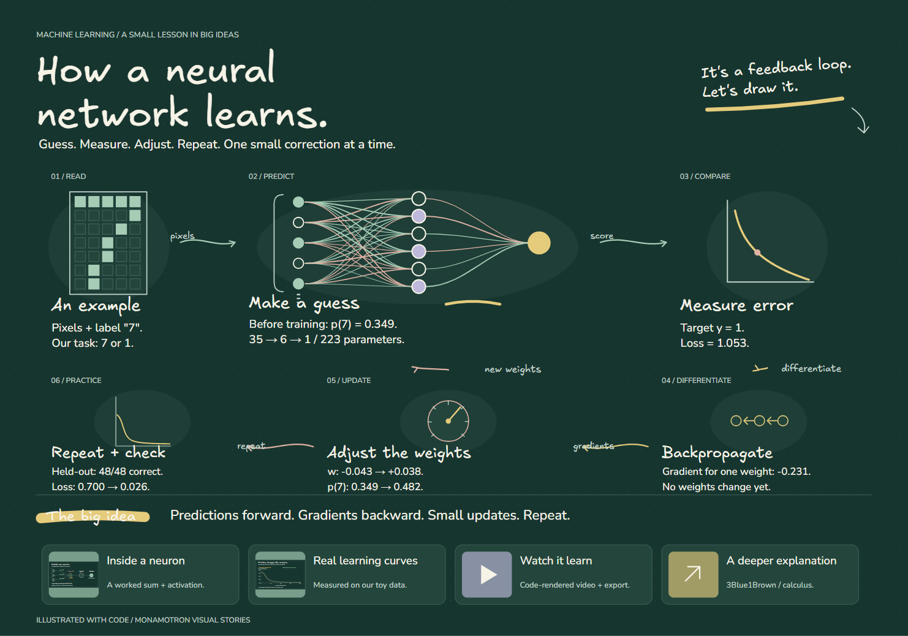

<div align="center">

# Monamotron

**Your AI explains ideas by drawing them.**

A portable AI skill for beautifully designed visual lessons: code-drawn illustrations, animated arrows, handwritten text, supporting images, and real video export.

[**Play the live demo**](https://ibrahim-hero.github.io/monamotron/) · [**Watch the video**](docs/media/neural-network-demo.webm) · [**Install the skill**](docs/INSTALLATION.md)

[](LICENSE)
[](package.json)
[](skill/monamotron/SKILL.md)

</div>

[](docs/media/neural-network-demo.webm)

> Click the board to watch the **~73-second WebM demo**, generated from the same code and timeline as the interactive lesson.

## Quick Start

1. [Download the release](https://github.com/ibrahim-hero/monamotron/releases/tag/v1.0.0) and extract it.
2. Copy the complete `skill/monamotron` folder into `.opencode/skills/` or `.claude/skills/`.
3. Restart your host where required, load the skill, and give it a topic:

```text
Load monamotron and explain how neural networks learn.
Use a beautiful chalkboard design, animated drawing and typing,
supporting images, and export a video.
```

The instructions are model-independent. Building and verifying new lessons uses the host's file, code, and browser tools. The included standalone examples can be opened directly in a browser.

## What It Does

Monamotron teaches an AI coding agent to turn a topic into a progressive visual lesson rather than a wall of text or generic diagram. It combines instructional design, illustration, motion, typography, media, and verification in one reusable skill.

- Produces original SVG/Canvas illustrations instead of relying on stock icons.
- Draws labeled arrows that communicate actual relationships.
- Reveals drawings and text on a deterministic, seekable timeline.
- Includes Excalifont, Virgil, and Nunito for consistent offline rendering.
- Offers eight art directions: studio sketch, clean board, blueprint, chalkboard, editorial, playful, midnight, and notebook.
- Supports images, linked resources, generated video previews, PNG, SVG, JSON, and WebM exports.
- Reflows lessons for phones and respects reduced-motion preferences.
- Requires the agent to render, inspect, and validate the actual artifact.

## Featured Example

The neural-network lesson is not a mocked screenshot. Its prediction changes, gradient, weight update, and learning curves come from a reproducible **35 → 6 → 1** toy classifier with tested backpropagation.

- [Play the interactive lesson](https://ibrahim-hero.github.io/monamotron/)
- [Download or inspect the standalone HTML](docs/index.html)
- [Watch the generated WebM video](docs/media/neural-network-demo.webm)
- [View the full board](docs/media/neural-network-preview.png)
- [Inspect the editable example source](examples/neural-network/)
- [Read the numerical experiment results](examples/neural-network/experiment-results.json)

To publish the interactive lesson as a website, enable GitHub Pages from the repository's `/docs` folder.

## Install The Skill

Copy the complete [`skill/monamotron`](skill/monamotron/) folder into your AI host's skill directory.

| Host | Project installation |
| --- | --- |
| OpenCode | `.opencode/skills/monamotron/` |
| Claude Code | `.claude/skills/monamotron/` |
| Agents-compatible hosts | `.agents/skills/monamotron/` |
| No skill loader | Provide `SKILL.md` as instructions and make the adjacent assets/references available |

OpenCode users can also copy [`commands/opencode/monamotron.md`](commands/opencode/monamotron.md) into `.opencode/commands/`, restart OpenCode, and run:

```text
/monamotron Explain how neural networks learn. Use a beautiful chalkboard design, animated drawings and typing, supporting images, and export a video.
```

See [Installation](docs/INSTALLATION.md) for global paths, ZIP installation, and host-specific details.

## Use It

Ask the model to load `monamotron`, then describe the lesson and desired direction:

```text
Load monamotron and explain how DNS finds a website.
Use a technical blueprint style, code-drawn illustrations,
human-paced typing, useful media, and export a video.
```

The skill guides the agent through research, art direction, storyboarding, scene authoring, rendering, responsive checks, and export. It chooses sensible defaults unless a material ambiguity blocks the lesson.

## Develop And Test

Requirements: Node.js 20+ and a modern Chromium browser. FFmpeg is optional and only needed for MP4 conversion.

```sh
npm install
npm test
npm run build
npm run check:browser
npm run verify
```

On Windows PowerShell, use `npm.cmd` if execution policy blocks `npm.ps1`.

Useful commands:

| Command | Purpose |
| --- | --- |
| `npm test` | Run runtime and neural-network numerical tests |
| `npm run build` | Rebuild the solar and neural-network standalone demos |
| `npm run check:browser` | Check real rendering, controls, mobile layout, fonts, and short video decoding |
| `npm run export:neural` | Export the full neural lesson and refresh public GitHub media |
| `npm run brand` | Regenerate the branded social-preview SVG/PNG |
| `npm run github:configure -- --owner YOUR_GITHUB_USERNAME` | Fill account-specific GitHub and demo URLs |
| `npm run verify` | Validate repository structure, local Markdown links, fonts, images, video, and skill metadata |
| `npm run package` | Produce a clean release ZIP outside development artifacts |

## Repository Map

```text
monamotron/
├── skill/monamotron/            # The portable agent skill and rendering runtime
├── commands/opencode/          # Optional OpenCode slash command
├── examples/neural-network/    # Full source for the featured chalkboard lesson
├── docs/                       # GitHub Pages demo, guides, and public media
├── scripts/                    # Repository verification, sync, and packaging tools
├── .github/                    # CI, issue forms, PR template, Dependabot
└── README.md                   # GitHub landing page
```

Read [Repository Structure](docs/REPOSITORY_STRUCTURE.md) for the complete tree and the purpose of every major file.

## Documentation

- [Complete Upload And Launch Playbook](docs/GITHUB_LAUNCH_PLAYBOOK.md)
- [Copy-Ready Launch Posts](docs/LAUNCH_POSTS.md)
- [Publish This Repository On GitHub](docs/GITHUB_PUBLISHING.md)
- [Repository Structure](docs/REPOSITORY_STRUCTURE.md)
- [Video And Media Guide](docs/VIDEO_AND_MEDIA.md)
- [Installation](docs/INSTALLATION.md)
- [Contributing](CONTRIBUTING.md)
- [Security](SECURITY.md)
- [Release Notes v1.0.0](RELEASE_NOTES_v1.0.0.md)

## Important Scope

- This is an **agent skill plus an artifact runtime**, not a hosted prompt-to-video API.
- A tool-enabled agent can build and verify files. A text-only model can provide source but cannot honestly claim to have rendered a video.
- HTML/SVG output can look Miro- or Excalidraw-inspired, but it is not a native Miro or `.excalidraw` file unless an agent explicitly creates and validates that format.
- Browser video export produces WebM. MP4 requires a compatible recorder or a real FFmpeg conversion.

## License And Fonts

The skill and runtime are available under the [MIT License](LICENSE). Bundled Excalifont, Virgil, and Nunito files retain their SIL Open Font License 1.1 terms. See [Third-Party Notices](THIRD_PARTY_NOTICES.md).

## Share What You Make

If Monamotron makes a topic clearer, **star the repository** and [share your lesson](https://github.com/ibrahim-hero/monamotron/discussions). Real examples, useful feedback, and contributions help shape the next release.
