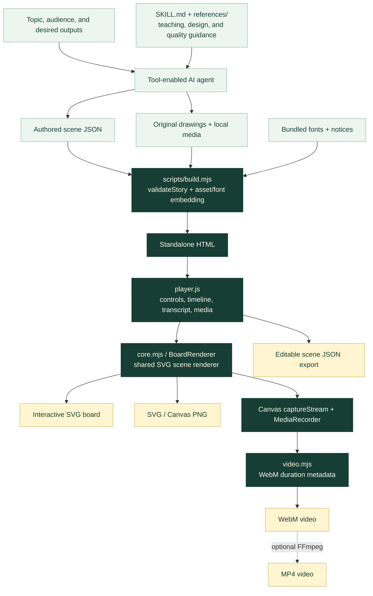
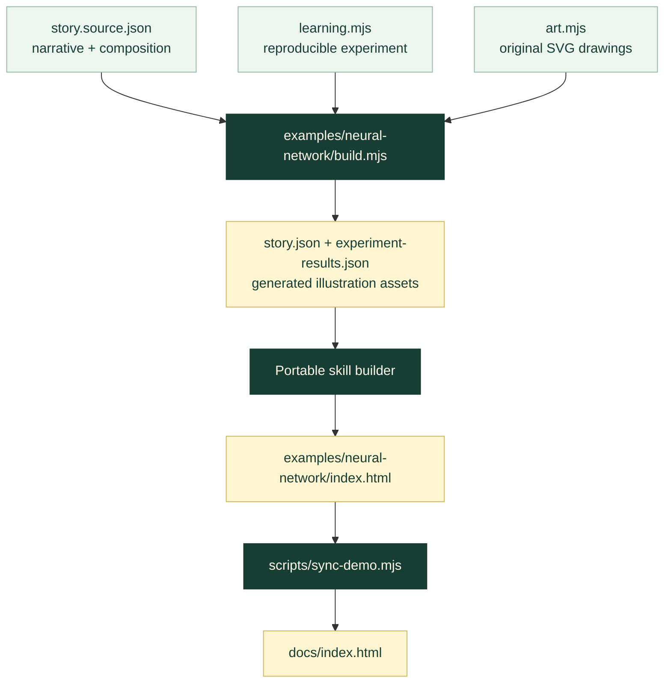

# Architecture

[← README](../README.md) · [Repository file map](REPOSITORY_STRUCTURE.md) · [Scene format](../skill/monamotron/references/scene-format.md)

Monamotron has three main parts: **instructions for an AI agent**, **a scene-driven rendering runtime**, and **tools that build, verify, and publish the result**. The AI host handles model access. The exported lesson runs in the browser using embedded JavaScript, CSS, fonts, and local media.

## System Overview



## 1. Agent Instructions

[`skill/monamotron/SKILL.md`](../skill/monamotron/SKILL.md) is the skill's entry point. It directs the agent to understand the topic, choose an art direction, plan the story, draw original artwork, build the lesson, inspect it in a browser, and deliver the requested outputs.

The supporting guides live in [`references/`](../skill/monamotron/references/):

- **Design system:** palettes, typography, composition, and the eight visual directions.
- **Scene format:** the JSON contract and examples for nodes, connections, custom drawings, and media.
- **Motion and media:** reveal timing, readable pacing, and export behavior.
- **Quality gates:** checks on conceptual accuracy, layout, playback, and delivered artifacts.

The complete `skill/monamotron/` folder is portable. A host discovers the instructions, while its execution tools run the included build and export scripts. The optional OpenCode command in [`commands/opencode/`](../commands/opencode/) provides a convenient invocation.

## 2. Scene Contract

The scene is the handoff between lesson authoring and rendering.

| Scene data | Responsibility |
| --- | --- |
| `title`, `subtitle`, `style`, `font` | Identity, art direction, and typography |
| `width`, `height`, `mobile` | Landscape composition and phone-layout overrides |
| `nodes`, `drawings` | Concepts, text, and original SVG path illustrations |
| `connections` | Labeled relationships between existing node IDs |
| `chapters`, `captions`, `summary` | Teaching sequence, written explanation, and final takeaway |
| `media`, `sources` | Embedded assets and outbound references |
| `seed`, `duration`, element timing fields | Reproducible reveals and the shared millisecond timeline |

[`scene.schema.json`](../skill/monamotron/references/scene.schema.json) assists scene authoring. [`validateStory()`](../skill/monamotron/assets/core.mjs) checks semantic rules such as valid connection endpoints, unique IDs, supported media, bounds, and timing. Browser checks add actual font measurement and rendered layout validation.

Use the [solar starter](../skill/monamotron/examples/solar-story.json) for a small complete scene. Use the [neural-network source](../examples/neural-network/story.source.json) for a lesson with calculated values and custom illustration code.

## 3. Standalone Build

[`skill/monamotron/scripts/build.mjs`](../skill/monamotron/scripts/build.mjs) performs the following steps:

1. Read and validate the scene JSON.
2. Resolve local media paths relative to the scene file and embed the bytes as data URLs.
3. Verify bundled font signatures and documented hashes, then embed their CSS and bytes.
4. Fill [`template.html`](../skill/monamotron/assets/template.html) with the scene, styles, renderer, player, video helper, and font notices.
5. Write a standalone HTML artifact and its accompanying `FONT-NOTICES.txt`.

The finished lesson needs no app server or CDN for its embedded content. Source/reference links remain ordinary outbound links. `--offline` requires the font cache to be present; the repository ships those font files.

## 4. Shared Rendering And Export

[`core.mjs`](../skill/monamotron/assets/core.mjs) contains the themes, typography helpers, validation, layout, and `BoardRenderer`. [`player.js`](../skill/monamotron/assets/player.js) owns playback state, controls, the transcript, media dialogs, and export actions. [`player.css`](../skill/monamotron/assets/player.css) styles the surrounding interface.

Playback, seeking, and export use the same scene timing and renderer. A fixed seed makes drawing geometry and typing cadence repeatable. An export renderer uses the landscape composition even when the interactive lesson is being viewed on a phone.

| Output | Path through the runtime |
| --- | --- |
| Interactive lesson | Timeline state → SVG board, with responsive layout and controls |
| SVG | Final scene → serialized SVG with embedded fonts |
| PNG | Final SVG → Canvas → encoded PNG |
| Scene JSON | Current scene data → editable JSON download |
| WebM | Timeline frames → Canvas → MediaRecorder → duration metadata repair |
| MP4 | Exported WebM → optional FFmpeg conversion |

Video recording runs in real time with a target frame rate. The scene timeline is deterministic; browser recording is not a promise of bit-for-bit identical encoded video or an exact frame count.

The standalone artifact exposes `window.monamotronBoard` for checks and automation:

```js
await window.monamotronBoard.ready;
window.monamotronBoard.seek(13000);
window.monamotronBoard.setStyle('blueprint');
const audit = window.monamotronBoard.audit();
const svg = window.monamotronBoard.exportSVG();
const png = await window.monamotronBoard.exportPNG({ width: 1600 });
// png.blob contains the encoded image.
```

## 5. Featured Example Pipeline

The neural-network example keeps its teaching narrative, numerical model, and illustration code independently editable.



The numerical code computes the displayed prediction, loss, gradient, parameter update, and learning curves. [`tests/learning.test.mjs`](../examples/neural-network/tests/learning.test.mjs) checks the network, including finite-difference verification of backpropagation. The dataset is a reproducible toy digit task.

The public media pipeline is:

```text
npm run build
  → rebuild scenes, calculations, illustrations, and HTML
npm run check:browser
  → check rendering; save the example screenshots used by the media sync
npm run export:neural
  → render the full WebM; sync public images, video, and social artwork
npm run demo:media
  → convert that WebM to a full-speed MP4 and a 5× animated GIF preview
```

The last command uses FFmpeg. [`docs/video.html`](video.html) plays the published MP4 with a WebM fallback. The README embeds the GIF so GitHub displays motion directly; the watch page provides normal-speed playback and controls. [Media guide →](VIDEO_AND_MEDIA.md)

## Build And Export A Scene

Run these commands from the repository root after `npm ci` and installing a supported browser:

```sh
node skill/monamotron/scripts/build.mjs --scene skill/monamotron/examples/solar-story.json --out dist/my-lesson.html --offline
node skill/monamotron/scripts/check-browser.mjs --input dist/my-lesson.html --out .artifacts/my-lesson-checks
node skill/monamotron/scripts/export.mjs --input dist/my-lesson.html --out dist/my-lesson-exports --png --svg --video
```

The first command produces `dist/my-lesson.html`. The last produces `explainer.png`, `explainer.svg`, `explainer.webm`, a decoded final video frame, and `exports.json` inside `dist/my-lesson-exports/`.

For your own lesson, change `--scene` to the authored JSON path. Its image/video paths are relative to that JSON file. Add `--mp4` to the export command when FFmpeg is installed.

## Where To Make A Change

| Goal | Edit | Verify / rebuild |
| --- | --- | --- |
| Improve the agent's teaching workflow | `skill/monamotron/SKILL.md`, `references/` | Create and inspect a representative lesson |
| Change scene fields or validation | `references/scene-format.md`, `scene.schema.json`, `assets/core.mjs` inside the skill | `npm test`, build, and browser checks |
| Adjust illustration rendering or layout | `skill/monamotron/assets/core.mjs` | Build and browser checks on desktop and mobile |
| Change player controls or styling | `skill/monamotron/assets/player.js`, `player.css`, `template.html` | Build and browser checks |
| Change the neural lesson | `examples/neural-network/story.source.json`, `learning.mjs`, `art.mjs` | Tests → build → browser checks → exports |
| Improve the GitHub presentation | `README.md`, `docs/*.md`, `docs/video.html` | `npm run verify`; inspect the rendered page |
| Refresh the video and animated preview | Example source, then the media pipeline above | Decode/play both full videos and inspect the GIF |
| Change release packaging | `scripts/create-release-zip.mjs` | `npm run package`; inspect the archive |

## Generated Files And Distribution

Built HTML, example scene data, computed evidence, generated illustrations, and public media are intentionally tracked so visitors can try the project immediately. Change their authoring sources, then run the appropriate build or export command.

- **Installable skill:** `skill/monamotron/` with its instructions, sources, fonts, and tools.
- **GitHub Pages:** the `docs/` directory contains the interactive examples, watch page, and public media. Publish `main` → `/docs`.
- **Release ZIP:** `npm run package` collects the repository into `dist/monamotron-v1.0.0.zip`.
- **Local artifacts:** dependencies, browser evidence, and temporary exports are excluded through the repository ignore and packaging rules.

See the [complete file map](REPOSITORY_STRUCTURE.md), [contributor guide](../CONTRIBUTING.md), and [publishing playbook](GITHUB_LAUNCH_PLAYBOOK.md) for the next level of detail.
